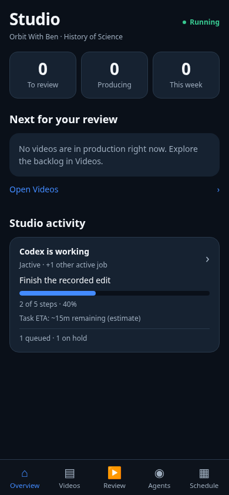

# Studio activity job card

The existing Overview card now shows the primary active job and opens its highlighted row in
Agents. Recorded urgency takes precedence; publisher order breaks ties. Shared records are
deduplicated by the existing model. The UI reads board.json only, changes no production state,
and keeps the queued/on-hold footer and idle/freshness handling.

Executed: Studio JS regression and activity unit tests; site build and syntax; whitespace/core
checks; Playwright activity, full tab/UAT and failure/refresh suites at 375/390/430/768/1280px.
Activity tests exercise multiple jobs, actual ID/action, recorded steps, supported ETA, queue
scroll/highlight, progress updates, missing-progress/no-ETA and idle transitions. Both Review
flows remain tested against intercepted fixtures. No live Review or workflow writes were sent.
Native Safari/device testing is not claimed. Screenshot uses a controlled board fixture in the
real built app, not production activity or a separate mockup.

Prepare preview and request Chief review before merge/production. No backend/publisher migration
is required. Run `node scripts/test_studio_activity_browser.cjs` against built dist served on
port 8765; Playwright/Chromium required. `STUDIO_PREVIEW_URL` and `CHROMIUM_PATH` are optional.
