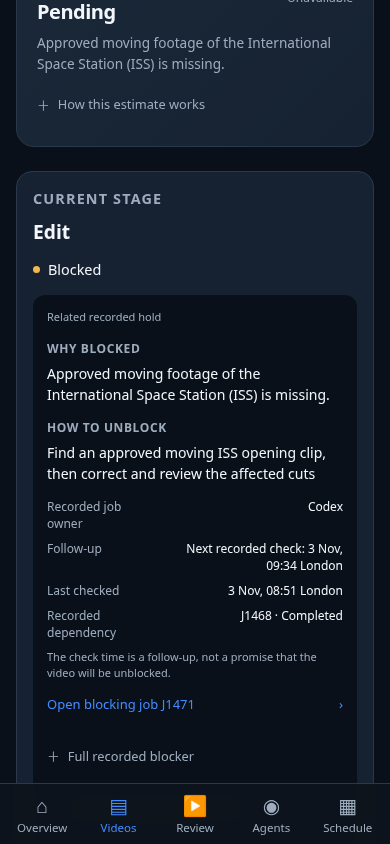

# Studio blocker guidance

The prior Edit card said only “Resolve the recorded blocker” and Unassigned. The source stage
contained a commit reference, while detailed holds were on associated jobs with no stage tag.
The UI now presents **Why blocked**, **How to unblock**, recorded job owner/reviewer, next check
(or overdue/missing state), last check, prerequisite status and a link to the highlighted job.
Original conditions and notes remain available in a disclosure. Other video holds are discoverable.

Selection is read-only and deterministic: explicit milestone/job mapping first, then an exact
recorded stage-reference match, then video-level holds with an explicit “stage link unconfirmed”
label. Video-level evidence is not silently promoted to stage ownership. Completed jobs are not
active blockers. A known stage approval is not explained using an unrelated video hold. Missing
reason/action/owner data is stated explicitly; no default Chief assignment or release ETA is invented.

For the actual OWB:030 snapshot, Edit references `d0b04b5e0`, matching J1471's recorded inspection.
Its hold says approved moving ISS opening footage is missing. The UI shows the recorded correction
action and Codex job owner; J1468 is labelled Completed from `owb.jobStates`, not as an unresolved
prerequisite. A check time is explicitly a follow-up, not a promised unblock time. Narrow source-backed
paraphrases make the ISS wording readable; full original conditions/actions remain available.

No production records, holds, owners, approval requirements, job states or publishing behaviour are
changed. Opening a blocker navigates to the existing Agents view; it does not unblock or approve it.
The existing UAT-forecast hero and Overview action use the same explanation.

## Executed QA

- JS syntax and regression/blocker tests passed: direct mapping versus references, multiple holds,
  unrelated video-level fallback, known reviewer, missing metadata, completed jobs, overdue checks,
  source preservation and escaping.
- Site build, whitespace, core locks, rules and STATUS checks passed.
- New Playwright suite passed **375/390/430/768/1280px**: source-reference reason/action/owner,
  prerequisite status, follow-up versus overdue, evidence disclosure, linked highlighted queue,
  missing metadata, no writes/page errors/horizontal overflow.
- Existing tab/UAT, activity, and failure/refresh suites passed at all five widths. Both UAT actions
  used intercepted fixtures; no live Review write was sent.
- Actual read-only OWB:030 production snapshot passed at **375/390/430px**, confirming the J1471
  reference, missing ISS input and completed prerequisite. The board JSON/signed watch URLs are
  not committed. Native Safari/device UAT is not claimed.

Reproduce: build the site, serve dist on port 8765, run `node scripts/test_studio_app.cjs` and
`node scripts/test_studio_blockers_browser.cjs` (Playwright/Chromium required). The browser suite
uses intercepted read-only fixtures. Preview and Chief review precede merge/production. This is
frontend-only and needs no publisher migration.
