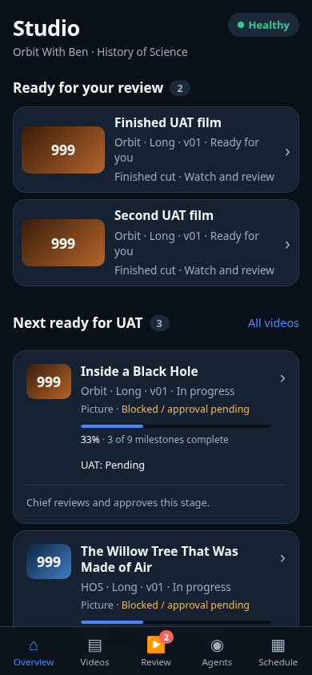
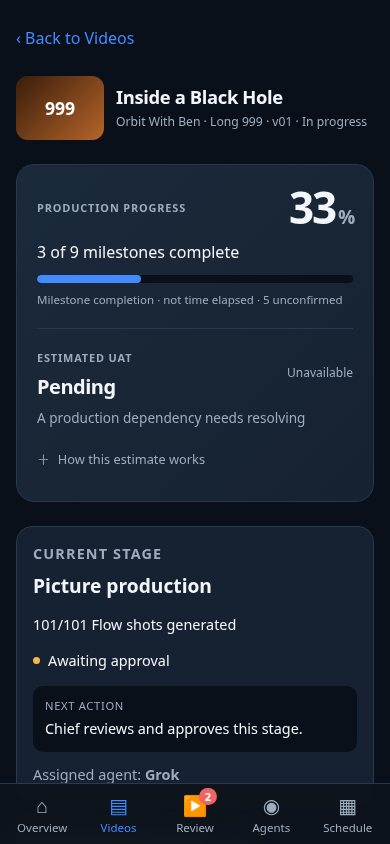
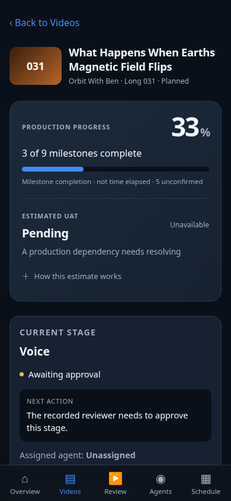

# Studio V2 review

Follow-up to merged PR #382. Monitoring/presentation changes only; production media, queue state,
publication dates, sign-offs and existing Review API documents remain unchanged.

## Evidence

- Python: **568 tests passed, one skipped** (`python3 -m unittest discover -s scripts -p 'test_*.py' -q`).
- Estimator: **15 tests passed**, including real Git history boundaries, approval waits, duplicate
  records, missing timestamps, separate channel/format histories, parallel paths, variability and
  partial-stage versus full-UAT estimates.
- Studio JS regression/V2 checks passed, including 3/9 = 33%, unknown/approval states, task/video
  separation, preserved source notes, deterministic pending-order handling and stale estimates.
- `core_sync.py check`, `sync_rules.py --check`, `studio.py status --check`, JavaScript syntax,
  `git diff --check` and the site build passed.
- Playwright/Chromium: **375, 390, 430 and 1280px**. All five tabs, deep links, sorting and backlog;
  keyboard disclosure controls and accessible labels; disclosure persistence on same-SHA refresh;
  no horizontal overflow; content clears fixed navigation and starts below the top inset.
- Both UAT actions exercised against intercepted fixture endpoints, verifying the exact OK/change
  documents and timestamped change note. No live approval was sent.
- Read-only current production `board.json`: OWB and HOS deep links plus all five tabs passed at
  **375, 390 and 430px**, with no page errors or overflow. The stored board snapshot and watch
  URLs are not committed.

Screenshots below were captured with the built application, not a separate mockup. The controlled
producer fixture makes the 33% milestone count and approval hold reproducible. The real-data image
uses a read-only production snapshot. Native iOS device testing remains a Chief/UAT check; Chromium
mobile viewports verify responsive layout, not Safari hardware behaviour.

## 390px review captures

### Overview (controlled producer fixture)

### Video detail (controlled producer fixture)

### OWB 031 with current production data

## Rollout and limits

PR #382 is merged and cannot accept a second reviewable diff. This follow-up links back to it and
requires Chief review before merge/production. Preview page deployment and Mini data publication
are separate; a preview reads current production data until the updated publisher is approved.

No calibrated numerical confidence is claimed. Unknown queue/manual/approval timing and insufficient
history stay unavailable. Stage-only estimates are explicitly labelled and expire with stale data.
Only long-form history is currently observed from the existing long-film status sources; Shorts
remain unavailable unless their own comparable evidence exists. Parent-film completion is never
copied to a Short. No historical source records are rewritten to improve progress figures.

Reproduce with the commands in the kanban README. Browser tests require Playwright and Chromium;
`CHROMIUM_PATH` can select the installed browser. All fixture writes are intercepted locally.
