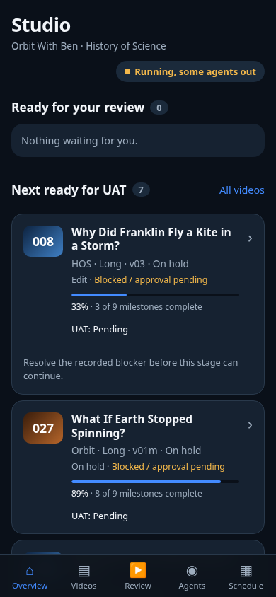
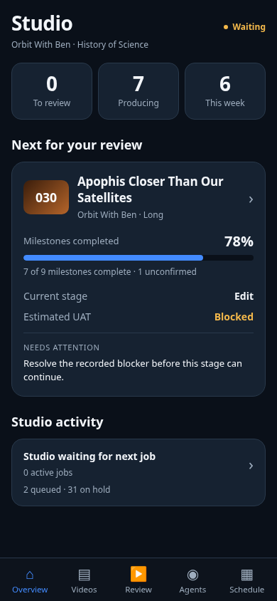
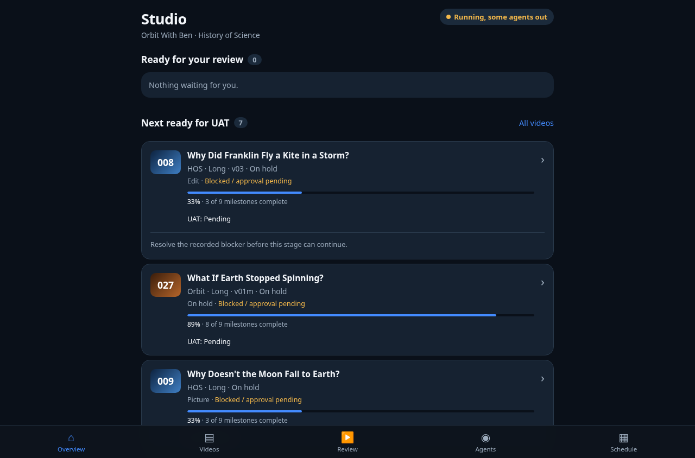
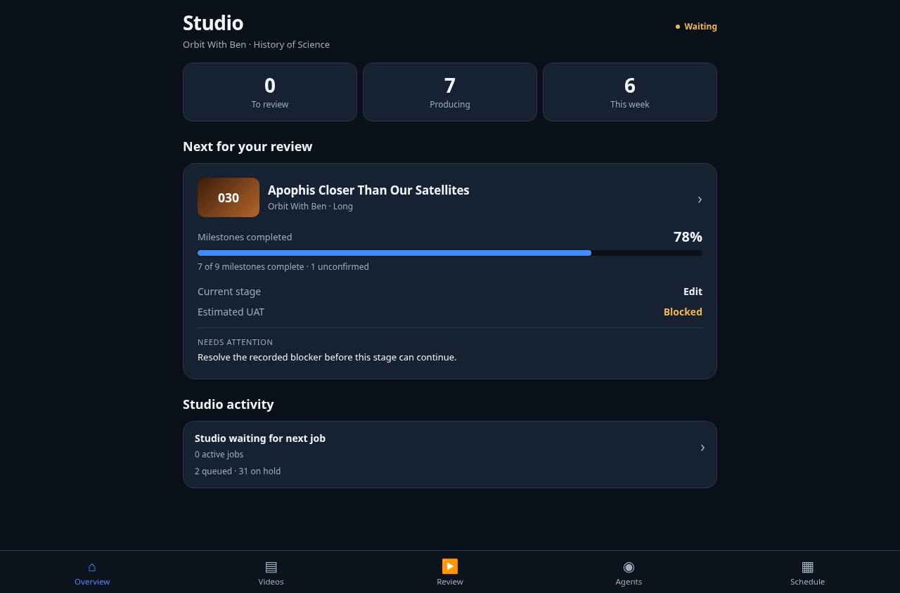

# Studio V3 Overview review

Focused follow-up to merged PRs #382 and #383. V2 detail/UAT behaviour is retained.
The change is presentation and read-only frontend selection; no publisher, job state, approval,
YouTube date/visibility or generation behaviour changes.

## What changed

Overview now has exactly the requested order: minimal linked operational status, three compact
video statistics, one featured UAT candidate, and one compact activity card. Operational records
remain in Agents, including an expandable queue and original job metadata. No raw job IDs,
long task titles, Chief counter or historical timing diagnostics appear on Overview.

Counts and linked lists share selectors. Producing means unique cards in the recorded active
pipeline lanes, excluding published/scheduled/done and cuts already awaiting Ben. Upcoming
records stay in Backlog, even when old stage notes describe partial work. Shared jobs count once
as activity and never become video counts. Cards deduplicate by stable key and explicit YouTube ID.

“This week” means Monday–Sunday in London, matching Schedule's labelled calendar week. Only
recorded YouTube schedules count, including overdue schedules until the readback says public;
a planned air date is separate. Distinct real videos sharing a slot remain distinct. Explicit
synthetic swap records are omitted when an actual YouTube video represents the same slot.

The featured selector orders recorded Ben-ready cuts first, avoids promoting blocked work over
progressing work just for its percentage, then considers credible ETA, proximity to QA, unresolved
milestones, recorded focus/priority, meaningful updates and stable key. This is a deterministic
readiness fallback, not a new prediction model. Numbers only come from the existing UAT forecast.

Operational status uses relay freshness, recorded active jobs, job timestamps and agent capacity.
A Chief being online is insufficient. A fresh job can show Running · Limited while relay data is
stale; without fresh work/health evidence the UI asks for attention. Agent names require recent
job activity. The expandable Agents queue preserves stale claimed records as recorded metadata.

## Executed validation

- **568 Python tests passed, one skipped** (repository-wide `scripts/test_*.py`).
- Studio JS regression and V3 selector tests passed: unique video/job counts, published follow-up
  jobs, real schedules versus plans, London/BST week boundaries, same-slot distinct videos,
  missing milestones/ETA, blocked/focus/credible candidate ranking and stale health/activity.
- Build, JS syntax, core locks, rules, STATUS consistency and whitespace checks passed.
- Playwright/Chromium at **375, 390, 430, 768, 1280px** passed all five tabs; status, statistic and
  featured-card navigation; scope resets from stale channel/type/backlog filters; V2 deep links,
  keyboard milestones, disclosure persistence, UAT note preservation and both intercepted UAT
  actions. Queue details remain accessible in Agents and absent from Overview.
- Separate failure/refresh tests passed at all five widths: loading, 503/retry, retained loaded
  content during refresh failure, unchanged DOM and no extra board read on the same SHA, very
  long titles, missing milestones, broken thumbnail fallback, no horizontal overflow and bottom
  navigation clearance. No live Review writes were sent.

Native iOS Safari/device behaviour is not claimed by Chromium viewport checks and remains UAT.
Reproduction: build the site, serve dist on port 8765, run `node scripts/test_studio_app.cjs`,
`node scripts/test_studio_uat_browser.cjs`, and `node scripts/test_studio_overview_browser.cjs`.
The browser tests require Playwright and Chromium (`CHROMIUM_PATH` may override its location).

## Before and after

These are captures of the existing application, using the **same read-only production board
snapshot** for both versions. Before uses the deployed V2 page; after uses the built V3 page.
No successful forecast or production state was fabricated for the screenshots. Counts may differ
from the current live board because the captured snapshot is fixed and V3 fixes the definitions.
The board JSON and signed watch URLs are not committed.

| Before · 390px | After · 390px |
| --- | --- |
|  |  |

[375px](after-375.png) · [430px](after-430.png) · [Tablet 768px](after-768.png)

| Before · desktop | After · desktop |
| --- | --- |
|  |  |

## Release

Request Chief review before merge/production. Existing Vercel project settings and independent
Mini board publisher are unchanged. V3 needs a page deployment after approval; no telemetry
migration or second data source is required. Production verification follows an authorised release.
