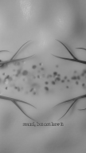
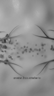

# J2557 — Whole-Short Full-Bleed Gate Check Across All Scheduled Shorts (OWB + HOS) vs. By-Eye Audit (`J2545`)

- **Job:** `J2557` (`Shorts gate, part 3: run the whole-Short check on every scheduled Short of both channels and compare it with the by-eye audit`)
- **Agent:** `gemini`
- **Date:** 11 Nov 2026 (`2026-11-11T04:55Z`)
- **Repos & Gate Commits:**
  - `orbit-with-ben`: `origin/main` (includes PR `#790` / `J2546` whole-Short `full_bleed` check in `00_Brand/Channel-Setup/tools/gate_shorts_open.py`)
  - `History Of Science`: `origin/main` (`f022267e`, includes PR `#499` syncing the `J2546` whole-Short `full_bleed` check to HOS `00_Brand/Channel-Setup/tools/gate_shorts_open.py`)
- **Detached Run Provenance:**
  - `tmux` session: `J2557-gate`
  - Log file: `~/_desk/logs/J2557-gate.log` (`31` runs across all `30` Shorts from `J2545` + the `J2509` 720p Studio download of `kKN8Ale42sE`, completed in `111.59 s`)
  - Exit status file: `~/_desk/logs/J2557-gate.done` (`0`)
  - Raw JSON results: `~/_desk/logs/J2557-results.json`
- **Scope & Spend:** Read-only, `£0`. Nothing re-cut, nothing changed in Studio, and no changes made to `gate_shorts_open.py` or its thresholds.

---

## Executive Summary

Across the **30 Shorts** in the `J2545` by-eye audit (`23` scheduled `OWB` Shorts + `1` `10 Nov` reference Short `ffYKoNVPoqg`, and `6` scheduled `HOS` Shorts):

1. **Every body-padded Short in the audit is caught by the whole-Short check (`0` false negatives at the Short level):**
   - All **8** scheduled `OWB` Shorts with padded body shots (`bSjWiCbB7pY`, `kKN8Ale42sE`, `rvug71d7Dqk`, `xdurJQcoiGM`, `C8lPx5N2DwM`, `SWDCZfWZVao`, `k2kEaA7ICjc`, `heiGCnGKTkE`) plus the `10 Nov` reference Short (`ffYKoNVPoqg`) exceed the `10%` padded-frame threshold (`19%` to `72%` of sampled body frames).
   - `OWB` `bSjWiCbB7pY` (`2026-11-13`, `fri13_ingenuity_72_v06.mp4`) is flagged at `12/27` frames (`44%`: `3.0–6.0 s` and `10.0–19.0 s`, matching the audit's `2.8–5.9 s` and `9.9–18.9 s`) and is downgraded from `FAIL` to `WARN` (`PASS`) solely because its exact SHA-256 (`54929328bd...`) is listed in `full_bleed_okd_before_rule.json`.
2. **End-card-only Shorts with `_meta.json` `end_card.start_s` pass cleanly (`WARN` only):**
   - `OWB` `aEfdxex__Bo` (`2026-11-16`, `mon16_cant_see_nearest_star_v06.mp4`, was `HZGTovJu_TQ` in `J2545`) and `OWB` `dH_yCRmzkMo` (`2026-11-18`, `wed18_robot_reach_nearest_star_v07.mp4`, was `cwU_0WWeNZ4` in `J2545`) have `0` padded body frames (`0/23` and `0/20`) and `4/4` padded end-card frames (`23.0–27.0 s` and `20.0–24.0 s`), which the gate leaves out of the body denominator via `end_card_window_s` and reports as a non-blocking `WARN`.
3. **Only 1 full-frame Short out of 19 is falsely failed by the whole-Short gate (`List 1`):**
   - `HOS` `Wvjd8g0CpzE` (`2026-11-15`, `hos_005_s03_never_saw_v04.mp4`) is full-frame `9:16` 3D cartoon throughout, but the gate flags `5.0–8.0 s` (`3/26` frames = `11.5% > 10%`, `1` frame over the `2.6`-frame limit) as `"blur-pad"` because the shot has detailed red/blue capillary branches and blood cells across the middle third while the top and bottom thirds are softly shaded, smooth pink living tissue (`sharp_top ≈ 2.5%`, `sharp_bot ≈ 7.7% <= 8.5%`, `outside_smooth_std ≈ 11–17 >= 8.0`).
   - Meanwhile, `HOS` `ChbsigHD5_o` (`2026-11-18`, `hos_006_s01_mirror_flaw_v01.mp4`), which previously failed the old frame-0 heuristic on a dark blurred night sky, now **PASSES 100%** (`0/25` frames padded).

*(Note on 3 swapped `OWB` YouTube IDs since `J2545`: queued swap jobs `J2511`, `J2513`, and `J2514` replaced the YouTube IDs for Rows 5, 6, and 8 in `UPLOADS.json` using the exact same `.mp4` files and SHA-256 hashes audited in `J2545`: `gmzaCfJF1gA` → `z5V6gIXXYs8`, `HZGTovJu_TQ` → `aEfdxex__Bo`, and `cwU_0WWeNZ4` → `dH_yCRmzkMo`. Both IDs are shown in the table below.)*

---

## 1. Master Comparison Table (All 30 Shorts from `J2545`)

Each row was checked with:
```bash
python3 00_Brand/Channel-Setup/tools/gate_shorts_open.py check <file> --air-date <YYYY-MM-DD> --id <video_id> --report-only --json
```
from its channel's repo (`orbit-with-ben` or `History Of Science`).

| # | Video ID (`J2545` ID if swapped) | Ch | Air Date | `padded_stretches_s` (`padded / body_checked`) | `end_card_window_s` | Whole-Short Rule Fails It? | By-Eye Audit (`J2545` §2) |
|---:|---|---|---|---|---|---|---|
| 1 | `ffYKoNVPoqg` | OWB | `2026-11-10` *(ref)* | `[[0.0, 8.0, "blur-pad"], [13.0, 18.0, "blur-pad / mirror"]]` (`13/18` = `72.2%`) | `None` | **YES (`FAIL`)** *(+ frame-0 `FAIL`)* | **Padded:** `13.0 s / 18.00 s` (`72.2%`): `0.0–2.7 s` (`blur-pad`), `2.7–7.7 s` (`bars`), `12.7–18.0 s` (`bars`) |
| 2 | `B1z2dv7m7Vk` | OWB | `2026-11-11` | `[]` (`0/26` = `0.0%`) | `None` | **NO (`PASS`)** | **Full frame throughout** (`0.0 s / 26.03 s`) |
| 3 | `uhZSRcvngvE` | OWB | `2026-11-12` | `[]` (`0/55` = `0.0%`) | `None` | **NO (`PASS`)** *(full-bleed PASS; duration needs `--length-test`)* | **Full frame throughout** (`0.0 s / 54.63 s`) |
| 4 | `bSjWiCbB7pY` | OWB | `2026-11-13` | `[[3.0, 6.0, "blur-pad"], [10.0, 19.0, "blur-pad / mirror"]]` (`12/27` = `44.4%`) | `None` | **Raw rule: YES (`44.4% > 10%`); Gate: `WARN`/`PASS`** *(SHA-256 in `full_bleed_okd_before_rule.json`)* | **Padded:** `12.1 s / 26.40 s` (`45.8%`): `2.8–5.9 s` (`blur-pad`), `9.9–18.9 s` (`blur-pad`) — Ben-approved `v06` |
| 5 | `z5V6gIXXYs8` *(was `gmzaCfJF1gA`)* | OWB | `2026-11-14` | `[]` (`0/18` = `0.0%`) | `None` | **NO (`PASS`)** | **Full frame throughout** (`0.0 s / 17.60 s`, `v02` re-cut) |
| 6 | `aEfdxex__Bo` *(was `HZGTovJu_TQ`)* | OWB | `2026-11-16` | `[[23.0, 27.0, "blur-pad"]]` (`0/23` body = `0.0%`; `4/4` end card) | `[22.63, 26.48]` | **NO (`PASS`, end-card `WARN`)** | **Body `0.0–22.6 s` full frame; End-card only:** `22.6–26.5 s` (`3.9 s / 26.50 s`, `14.7%`, `blur-pad`) |
| 7 | `kKN8Ale42sE` *(disk 1080p `v01`)* | OWB | `2026-11-17` | `[[5.0, 9.0, "blur-pad"]]` (`4/21` = `19.0%`) | `None` | **YES (`FAIL`)** | **Padded:** `2.3 s / 20.74 s` (`11.1%`): `4.6–6.9 s` (`blur-pad`) |
| 7b | `kKN8Ale42sE` *(Studio 720p `J2509`)* | OWB | `2026-11-17` | `[[0.0, 5.0, "blur-pad"], [7.0, 9.0, "blur-pad"], [19.0, 21.0, "blur-pad"]]` (`9/21` = `42.9%`) | `None` | **YES (`FAIL`)** | *(Live YouTube stream from `J2509`: `0.0–4.6 s` & `18.4–20.74 s` blur-padded; `4.6–6.9 s` reframed)* |
| 8 | `dH_yCRmzkMo` *(was `cwU_0WWeNZ4`)* | OWB | `2026-11-18` | `[[20.0, 24.0, "blur-pad"]]` (`0/20` body = `0.0%`; `4/4` end card) | `[19.75, 23.6]` | **NO (`PASS`, end-card `WARN`)** | **Body `0.0–19.8 s` full frame; End-card only:** `19.8–23.6 s` (`3.8 s / 23.60 s`, `16.1%`, `blur-pad`) |
| 9 | `aAUgIGEuPwQ` | OWB | `2026-11-20` | `[]` (`0/24` = `0.0%`) | `None` | **NO (`PASS`)** | **Full frame throughout** (`0.0 s / 23.40 s`) |
| 10 | `rvug71d7Dqk` | OWB | `2026-11-21` | `[[3.0, 4.0, "blur-pad"], [11.0, 23.0, "blur-pad"]]` (`13/23` = `56.5%`) | `None` | **YES (`FAIL`)** | **Padded:** `7.0 s / 22.20 s` two-sided (`0.0–3.0 s`, `18.2–22.2 s`); `22.20 s / 22.20 s` (`100%`) incl. `3.0–18.2 s` bottom-only `blur-pad` |
| 11 | `Dm4xsF1Ateg` | OWB | `2026-11-23` | `[]` (`0/23` = `0.0%`) | `None` | **NO (`PASS`)** | **Full frame throughout** (`0.0 s / 22.97 s`) |
| 12 | `xdurJQcoiGM` | OWB | `2026-11-25` | `[[15.0, 19.0, "blur-pad"]]` (`4/19` = `21.1%`) | `None` | **YES (`FAIL`)** | **Padded:** `3.6 s / 18.40 s` (`19.6%`): `14.8–18.4 s` (`blur-pad`) |
| 13 | `93JL_IK57EM` | OWB | `2026-11-27` | `[]` (`0/20` = `0.0%`) | `None` | **NO (`PASS`)** | **Full frame throughout** (`0.0 s / 19.37 s`) |
| 14 | `MScK2CK2ZFg` | OWB | `2026-11-28` | `[]` (`0/18` = `0.0%`) | `None` | **NO (`PASS`)** | **Full frame throughout** (`0.0 s / 17.07 s`) |
| 15 | `xvarZP2aYyE` | OWB | `2026-11-30` | `[]` (`0/23` = `0.0%`) | `None` | **NO (`PASS`)** | **Full frame throughout** (`0.0 s / 22.23 s`) |
| 16 | `v6euXX2omz4` | OWB | `2026-12-02` | `[]` (`0/25` = `0.0%`) | `None` | **NO (`PASS`)** | **Full frame throughout** (`0.0 s / 24.50 s`) |
| 17 | `BTuL_QBbEgY` | OWB | `2026-12-04` | `[]` (`0/24` = `0.0%`) | `None` | **NO (`PASS`)** | **Full frame throughout** (`0.0 s / 23.10 s`) |
| 18 | `C8lPx5N2DwM` | OWB | `2026-12-05` | `[[9.0, 12.0, "blur-pad"], [15.0, 32.0, "blur-pad"]]` (`20/33` = `60.6%`) | `None` | **YES (`FAIL`)** | **Padded:** `20.6 s / 33.00 s` (`62.4%`; `24.3 s / 73.6%` incl. `4.7–8.4 s`): `8.4–11.4 s`, `14.1–31.7 s` (`+ 4.7–8.4 s`) |
| 19 | `lsOCcIYCud0` | OWB | `2026-12-07` | `[]` (`0/24` = `0.0%`) | `None` | **NO (`PASS`)** | **Full frame throughout** (`0.0 s / 23.10 s`) |
| 20 | `SWDCZfWZVao` | OWB | `2026-12-09` | `[[3.0, 6.0, "blur-pad"], [9.0, 16.0, "blur-pad"]]` (`10/23` = `43.5%`) | `None` | **YES (`FAIL`)** | **Padded:** `5.2 s / 22.70 s` (`22.9%`): `2.7–5.1 s` (`blur-pad`), `12.4–15.2 s` (`blur-pad`) |
| 21 | `k2kEaA7ICjc` | OWB | `2026-12-11` | `[[0.0, 3.0, "blur-pad"], [13.0, 19.0, "blur-pad"], [22.0, 27.0, "blur-pad"], [33.0, 34.0, "blur-pad"]]` (`15/34` = `44.1%`) | `None` | **YES (`FAIL`)** *(+ frame-0 `FAIL`)* | **Padded:** `12.5 s / 33.90 s` (`36.9%`; `16.1 s / 47.5%` incl. `8.6–12.2 s`): `12.2–19.2 s`, `21.5–27.0 s` (`+ 8.6–12.2 s`) |
| 22 | `QEoYKIVvKBA` | OWB | `2026-12-12` | `[]` (`0/25` = `0.0%`) | `None` | **NO (`PASS`)** | **Full frame throughout** (`0.0 s / 24.48 s`) |
| 23 | `heiGCnGKTkE` | OWB | `2026-12-14` | `[[6.0, 9.0, "blur-pad"], [13.0, 17.0, "blur-pad"], [20.0, 22.0, "blur-pad"]]` (`9/24` = `37.5%`) | `None` | **YES (`FAIL`)** | **Padded:** `9.1 s / 23.93 s` (`38.0%`): `5.8–8.9 s`, `12.4–16.2 s`, `19.8–22.0 s` (`blur-pad`) |
| 24 | `f17XCtUmN-g` | OWB | `2026-12-16` | `[[11.0, 12.0, "blur-pad"]]` (`1/21` body = `4.8%`; `0/2` end card) | `[20.92, 22.36]` | **NO (`PASS`, `1/21 <= 10%` `WARN`)** | **Full frame throughout** (`0.0 s / 22.37 s`) |
| 25 | `cLKDiYP55J8` | HOS | `2026-11-13` | `[[9.0, 10.0, "blur-pad"]]` (`1/23` = `4.3%`) | `None` | **NO (`PASS`, `1/23 <= 10%` `WARN`)** | **Full frame throughout** (`0.0 s / 22.40 s`) |
| 26 | `Wvjd8g0CpzE` | HOS | `2026-11-15` | `[[5.0, 8.0, "blur-pad"]]` (`3/26` = `11.5%`) | `None` | **YES (`FAIL`, `3/26 > 10%`)** | **Full frame throughout** (`0.0 s / 25.26 s`) |
| 27 | `xzKoHg0E0_U` | HOS | `2026-11-16` | `[]` (`0/25` = `0.0%`) | `None` | **NO (`PASS`)** | **Full frame throughout** (`0.0 s / 24.53 s`) |
| 28 | `xgx2lYHhYZM` | HOS | `2026-11-17` | `[[14.0, 15.0, "blur-pad"]]` (`1/25` = `4.0%`) | `None` | **NO (`PASS`, `1/25 <= 10%` `WARN`)** | **Full frame throughout** (`0.0 s / 24.53 s`) |
| 29 | `ChbsigHD5_o` | HOS | `2026-11-18` | `[]` (`0/25` = `0.0%`) | `None` | **NO (`PASS`)** | **Full frame throughout** (`0.0 s / 24.25 s`) |
| 30 | `Bks_JLId1ew` | HOS | `2026-11-21` | `[]` (`0/26` = `0.0%`) | `None` | **NO (`PASS`)** | **Full frame throughout** (`0.0 s / 25.17 s`) |

---

## 2. The Three Short Lists

### List 1 — Shorts the audit calls `"Full frame throughout"` that the gate FAILS

Out of the **19** Shorts (`13 OWB + 6 HOS`) that the `J2545` by-eye audit classified as `"Full frame throughout"`, the whole-Short rule fails **1 Short**:

1. **`HOS` `Wvjd8g0CpzE` (`2026-11-15`, `005_Your-Heart-Doesnt-Pump-What-Galen-Got-Wrong/03_Shorts/hos_005_s03_never_saw_v04.mp4`, Row 26)**
   - **Gate output:** `padded_stretches_s = [[5.0, 8.0, "blur-pad"]]` (`3/26` sampled frames = `11.5%`, which is `1` frame above the `10%` allowance of `int(26 * 0.10) = 2` frames).
   - **Saved `108×192` grey frames beside this report:**
     - [`Wvjd8g0CpzE_t05s_108x192_gray.png`](Wvjd8g0CpzE_t05s_108x192_gray.png) (`t = 5.0 s`):
       - `sharp_top_pct = 2.5%`, `sharp_mid_pct = 23.2%`, `sharp_bot_pct = 7.5%`, `outside_smooth_std = [17.01, 10.88]`
     - [`Wvjd8g0CpzE_t06s_108x192_gray.png`](Wvjd8g0CpzE_t06s_108x192_gray.png) (`t = 6.0 s`):
       - `sharp_top_pct = 2.6%`, `sharp_mid_pct = 30.5%`, `sharp_bot_pct = 7.9%`, `outside_smooth_std = [16.83, 11.39]`
     - *(At `t = 7.0 s`, the same shot has `sharp_top_pct = 2.6%`, `sharp_mid_pct = 32.0%`, `sharp_bot_pct = 7.8%`, `outside_smooth_std = [16.71, 11.42]`.)*
   - **What is in the picture (`5.0–8.0 s`):**
     - It is a genuinely full-bleed `9:16` 3D cartoon microscopic view inside living tissue (`"round, but not how it"` at `5.0 s`, `"crosses from arteries to"` at `6.0 s`, `"veins. Harvey never saw a"` at `7.0 s`).
     - A branching red artery enters from the left and a branching blue vein enters from the right, with red and blue blood cells streaming horizontally across the **middle third** of the vertical frame (`y = 26%–74%`).
     - The **top quarter (`0%–26%`)** and **bottom quarter (`74%–100%`)** of the `9:16` frame show the surrounding soft-focus pink/coral tissue walls and smooth lighting gradients, plus the burned-in subtitle in the lower band. Because all the fine vessel branches and blood cells sit in the middle third (`sharp_mid = 23%–32% >= 10%`) while the pink tissue above and below has smooth shading gradients (`outside_smooth_std = 10.9–17.0 >= 8.0`) and few sharp pixel-to-pixel edges (`sharp_top = 2.5%–2.6%`, `sharp_bot = 7.5%–7.9%`, both `<= 8.5%`), `full_bleed_frame()` classifies all three seconds of that shot as `"blur-pad"`.

| `Wvjd8g0CpzE` at `t = 5.0 s` (`108×192` grey) | `Wvjd8g0CpzE` at `t = 6.0 s` (`108×192` grey) |
|---|---|
|  |  |

#### Related Note: Single-Frame False-Positive `blur-pad` Triggers That Did Not Fail a Full-Frame Short (`<= 10%`) or Occurred Inside Already-Padded Shorts
- **Three full-frame Shorts had a single 1-second `blur-pad` flag (`1` frame `<= 10%`, so the gate passed them with a `WARN`):**
  1. `OWB` `f17XCtUmN-g` (`2026-12-16`, Row 24): `11.0–12.0 s` (`1/21` = `4.8%`) — full-frame shot of the white rotating space-station wheel across the middle over soft blue/purple nebula top and bottom (`sharp_top/mid/bot = 1.6% / 20.6% / 8.0%`).
  2. `HOS` `cLKDiYP55J8` (`2026-11-13`, Row 25): `9.0–10.0 s` (`1/23` = `4.3%`) — full-frame 3D cartoon observatory dome at `t = 9.0 s` with the yellow title card `"How Did Hooke Prove / Robert Boyle's Law?"` in the middle and dark blue night sky above and dark floor below (`sharp_top/mid/bot = 6.9% / 22.8% / 8.4%`).
  3. `HOS` `xgx2lYHhYZM` (`2026-11-17`, Row 28): `14.0–15.0 s` (`1/25` = `4.0%`) — full-frame 3D cartoon shot of Harvey's hands tying a tourniquet on a forearm across the middle third with a softly lit anatomical chart above and dark table below (`sharp_top/mid/bot = 6.6% / 14.3% / 8.0%`).
- **Two already-padded `029` Betelgeuse Shorts also had false-positive `blur-pad` flags on their full-frame ESO/ALMA orange Betelgeuse gas-plume background:**
  - In `k2kEaA7ICjc` (`2026-12-11`, Row 21, `0.0–3.0 s` and `33.0–34.0 s`, which also caused a frame-0 `FAIL` at `0.0–0.5 s`) and `SWDCZfWZVao` (`2026-12-09`, Row 20, `9.0–12.0 s`), the full-frame vertical crop of the ESO/ALMA orange Betelgeuse dust plume has bright, smooth orange gas lobes in the upper/lower bands (`sharp_top <= 2.3%`, `outside_smooth_std >= 11`) while the burned-in title/hook text in the middle band pushes `sharp_mid >= 10%`. Similarly, in `kKN8Ale42sE` (`2026-11-17`, Row 7, `7.0–9.0 s`), the full-frame Sun-in-dark-space shot right after the `4.6–6.9 s` Voyager blur-pad shot has smooth lens-flare gradients at the top and bottom (`7.0 s` and `8.0 s`).

---

### List 2 — Shorts the audit calls padded that the gate PASSES, with the stretch it missed

1. **Shorts with padded body shots missed by the raw whole-Short rule:** **None (`0`).**
   - Every single Short with padded body shots in `J2545` (`ffYKoNVPoqg`, `bSjWiCbB7pY`, `kKN8Ale42sE`, `rvug71d7Dqk`, `xdurJQcoiGM`, `C8lPx5N2DwM`, `SWDCZfWZVao`, `k2kEaA7ICjc`, `heiGCnGKTkE`) is flagged above the `10%` threshold (`19.0%` to `72.2%`) by the whole-Short detector.
2. **Shorts with padded shots that exit `PASS` (`WARN`) by explicit rule design:**
   - **`OWB` `bSjWiCbB7pY` (`2026-11-13`, `fri13_ingenuity_72_v06.mp4`, Row 4):**
     - **Gate detection:** Caught `100%` of the padded stretches (`[[3.0, 6.0, "blur-pad"], [10.0, 19.0, "blur-pad / mirror"]]`, `12/27` frames = `44.4%`, matching the audit's `2.8–5.9 s` and `9.9–18.9 s`).
     - **Why it passes:** Its exact file SHA-256 (`54929328bd...`) is listed in `00_Brand/Channel-Setup/tools/full_bleed_okd_before_rule.json` (`J2546` exception for a cut Ben OK'd before the 8 Nov rule, until the `J2536` re-cut replaces it).
   - **`OWB` `aEfdxex__Bo` (`2026-11-16`, `mon16_cant_see_nearest_star_v06.mp4`, Row 6) & `OWB` `dH_yCRmzkMo` (`2026-11-18`, `wed18_robot_reach_nearest_star_v07.mp4`, Row 8):**
     - **Gate detection:** Caught `100%` of the end-card blur-pad stretches (`[[23.0, 27.0, "blur-pad"]]` and `[[20.0, 24.0, "blur-pad"]]`, `4/4` end-card frames each, matching the audit's `22.6–26.5 s` and `19.8–23.6 s`), with `0` padded body frames.
     - **Why they pass:** Their `_meta.json` files specify `end_card.start_s` (`22.63 s` and `19.75 s`), and per Chief's ruling on `J2545` / `J2546`, an end card on a blurred copy is reported as a `WARN`, not failed.
3. **Sub-stretches missed inside body-padded Shorts that the gate still FAILS overall:**
   - **`OWB` `rvug71d7Dqk` (`2026-11-21`, Row 10 — Gate FAILS at `13/23` = `56.5%`):**
     - **Missed sub-stretch A (`0.0–3.0 s`):** Two-sided feathered blur-pad on the cosmic-ray particle shower opening (`0.0–2.0 s` has `sharp_top = 8.98% > 8.5%` because the upper feathered boundary + `"THEY / LIVE"` hook caption edges cross into the top band, and `t = 2.0 s` has `sharp_mid = 9.03% < 10.0%`). Documented as a known limit in `tests/test_gate_full_bleed.py`.
     - **Missed sub-stretch B (`4.0–11.0 s`):** Part of the `3.0–18.2 s` asymmetric bottom-only blur-pad (`76%` upper panel + `24%` blurred bottom strip). Because the upper `0%–26%` of the frame is dark black space above Earth's curved limb (`top_smooth_std < 8.0`), `full_bleed_frame()` only triggers when the `3×3` block-std of the top quarter crosses `8.0` (`t = 3.0 s` and `t = 11.0–18.0 s`).
   - **`OWB` `C8lPx5N2DwM` (`2026-12-05`, Row 18 — Gate FAILS at `20/33` = `60.6%`):**
     - **Missed sub-stretch (`4.7–8.4 s`, sampled at `5.0–8.0 s`):** A `16:9` dark-blue solar-wind graphic band (`"SOLAR WIND / MAGNETIC FIELD"`) composited over a heavily blurred dark-orange solar backdrop. Because the blurred backdrop is so dark and low-contrast (`outside_smooth_std ≈ 5.6–7.4 < 8.0`), it falls just under `BLUR_PAD_MIN_SMOOTH_STD = 8.0` (documented as a known borderline limit in `tests/test_gate_full_bleed.py`).
   - **`OWB` `k2kEaA7ICjc` (`2026-12-11`, Row 21 — Gate FAILS at `15/34` = `44.1%`):**
     - **Missed sub-stretch (`8.6–12.2 s`, sampled at `9.0–12.0 s`):** A `16:9` dark-blue Betelgeuse scale graphic (`"BETELGEUSE (700x SUN) / JUPITER'S ORBIT"`) composited with feathered top/bottom edges over a dark-blue/orange blurred background (`outside_smooth_std < 8.0` on one side and `sharp_bot > 8.5%` from the subtitle on the other; documented in `tests/test_gate_full_bleed.py`).

---

### List 3 — Shorts whose end card sits on fill and whose meta does not name the end card (the gate counts those seconds as shots)

First, note that the two `026` Shorts with dedicated 16:9 thumbnail end cards on blurred fill—**`aEfdxex__Bo` (`HZGTovJu_TQ` `v06`, Row 6)** and **`dH_yCRmzkMo` (`cwU_0WWeNZ4` `v07`, Row 8)**—**DO** name `end_card.start_s` (`22.63 s` and `19.75 s`) in their `_meta.json`, so `end_card_window_s` is populated and the gate excludes those `4` frames from the body shot count.

Across the remaining Shorts where `end_card_window_s` is `None` (either no `_meta.json` exists, `_meta.json` has no `end_card` key, or `end_card` has no `start_s`), the following Shorts have closing/end-card seconds sitting on blurred fill that the gate counts as regular body shots:

1. **`OWB` `xdurJQcoiGM` (`2026-11-25`, `owb_ar2_iss_2030_deorbit_v13.mp4`, Row 12)**
   - **Meta status:** No `_meta.json` file exists (`end_card_window_s = None`).
   - **What happens at the end (`14.8–18.4 s`, flagged as `15.0–19.0 s`, `4/19` frames = `21.1%`):** The final shot (`14.8–18.4 s`) is a `16:9` ISS module shot over a two-sided blurred copy, over which the closing end-card CTA (`"What Happened to Venus? / Full film on the channel"`) appears in the final seconds. Because there is no `_meta.json` naming an end-card window, all `4` frames (`15.0, 16.0, 17.0, 18.0 s`) are counted as body shots—and this `14.8–18.4 s` stretch is the **only** padded stretch in the Short.
2. **`OWB` `rvug71d7Dqk` (`2026-11-21`, `fri06_muons_ground_v04.mp4`, Row 10)**
   - **Meta status:** `fri06_muons_ground_v04_meta.json` exists but has no `end_card` key (`end_card_window_s = None`).
   - **What happens at the end (`18.2–22.2 s`, flagged inside `11.0–23.0 s`):** During the final shot (`18.2–22.2 s`), the end-card text (`"What Happens If You Travel Near Light Speed?"`) sits over a `16:9` sky/cloud shot with two-sided feathered blur-padding above and below. The gate counts those `4` frames (`19.0–22.0 s`) as body shots (`rvug71d7Dqk` also fails on its body shots at `3.0–4.0 s` and `11.0–18.0 s`).
3. **`OWB` `C8lPx5N2DwM` (`2026-12-05`, `031_short_testA_opening_flip_v01.mp4`, Row 18)**
   - **Meta status:** `031_short_testA_opening_flip_v01_meta.json` exists (`format: "test_a_opening_short"`) and has no `end_card` key (`end_card_window_s = None`).
   - **What happens at the end (`14.1–31.7 s`, flagged as `15.0–32.0 s`):** Because this is a Test A opening Short reframed from the `031` master with a `1080×1200` centre crop over a blurred `1080×1920` backdrop, the gate counts the entire `15.0–32.0 s` stretch through the closing seconds as body shots.
4. **`OWB` `heiGCnGKTkE` (`2026-12-14`, `029_short_mon14_half_moon_daylight_v04.mp4`, Row 23)**
   - **Meta status:** `029_short_mon14_half_moon_daylight_v04_meta.json` has an `end_card` object (`{"font_px": 53, "rows": ["Is Betelgeuse", "About to", "Explode?"]}`) **without `start_s`**, so `_end_card_window_s()` returns `None`.
   - **What happens at the end:** Its third padded stretch (`19.8–22.0 s`, flagged as `20.0–22.0 s`) is a `16:9` Moon graphic on blurred fill right up to `22.0 s` (counted as body shots), before transitioning at `22.0–23.93 s` to the final full-frame Betelgeuse end card (`22.0–23.93 s` is not on fill).
5. *(Note on `SWDCZfWZVao` and `k2kEaA7ICjc`: their `_meta.json` files also have `end_card` objects with `font_px` and `rows` but no `start_s`, so `end_card_window_s = None`. Their closing end card at `~20.5–22.7 s` and `~31.5–33.9 s` sits on the full-frame vertical crop of the ESO/ALMA orange Betelgeuse gas plume rather than a 16:9 band on fill, though `k2kEaA7ICjc` trips a 1-frame false-positive `"blur-pad"` at `33.0–34.0 s` on those smooth orange gas lobes as noted in List 1.)*
